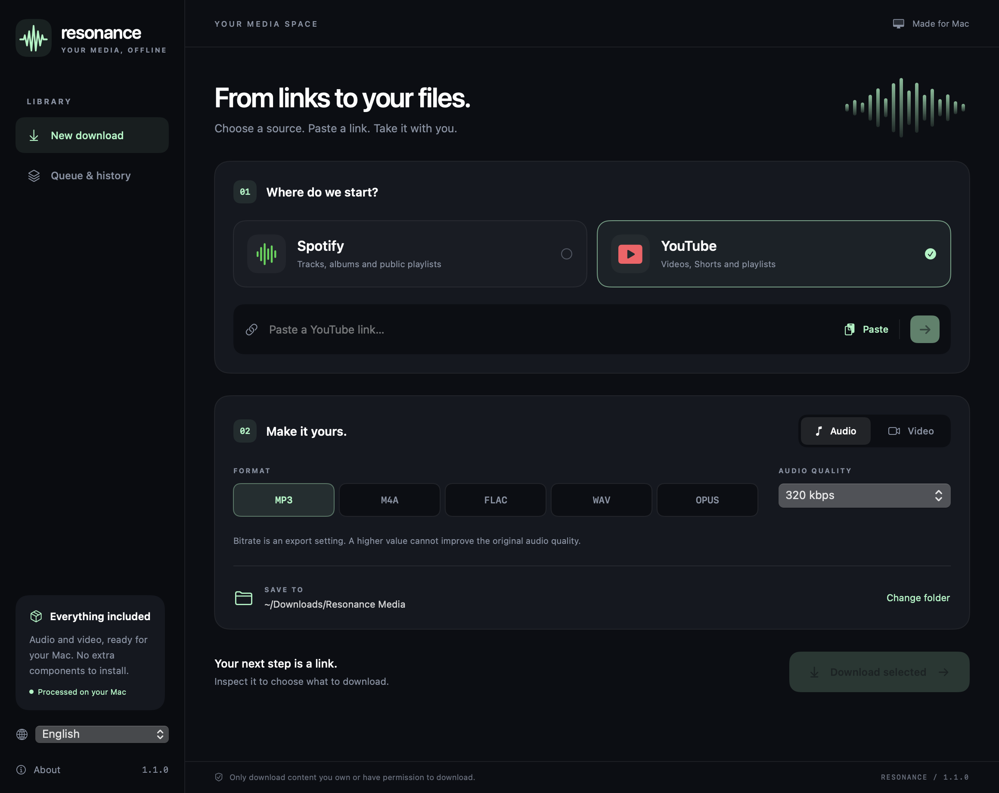

# Resonance

A compact native macOS app for audio and video downloads, with an English/Italian interface and signed updates from GitHub Releases.

[Italiano](docs/README.it.md) · [Download](https://github.com/tmacchioni/Resonance/releases/latest) · [Contributing](CONTRIBUTING.md) · [Security](SECURITY.md)



## Features

- YouTube videos, Shorts and public playlists; Spotify public track, album and playlist metadata with YouTube audio matching.
- Audio: MP3, M4A/AAC, FLAC, WAV and Opus. Video: MP4, MKV and WebM.
- Export bitrate and maximum video resolution, track selection, destination picker, queue, cancellation, retry and local history.
- English and Italian, switchable in the sidebar without restarting.
- Sparkle update checks at launch and daily while running. A new release always asks before installation. Downloads delay an update restart.
- A universal app for **macOS 13+, Apple Silicon and Intel**, with all runtime components included. No Homebrew, Python or other installation needed by users.

Only download content you own or have permission to download.

## Install and use

Get the `.pkg` from [Releases](https://github.com/tmacchioni/Resonance/releases/latest) and open it to install in `/Applications`. Alternatively, unzip the app and move it to Applications.

Choose a source, paste a link, inspect the available items, choose output settings and download. The queue shows progress and lets you reveal finished files in Finder. **About → Automatically check for updates** controls update checking; **Resonance → Check for Updates…** checks manually.

The initial public build is **signed ad hoc, not notarized by Apple**. Gatekeeper may require approval through System Settings → Privacy & Security. Apple Developer ID signing/notarization can be enabled by the maintainer; it is separate from the Ed25519 signatures used to authenticate updates. Never disable system protection globally.

## Source and quality limitations

Spotify supplies public metadata, **not the audio file**. Resonance searches YouTube for a matching recording, using title, artist and duration. You can specify an exact video for each track. Automatic matches may differ from the original edition. Spotify's public preview can expose only part of an album or playlist; the app shows a warning and does not guarantee complete Spotify collections. Private playlists and local Spotify files are unsupported.

Bitrate is an export setting, not proof of source fidelity. Exporting lossy audio as FLAC/WAV does not recover lost information. MP4 uses available H.264/AAC streams; higher resolutions or newer codecs may require MKV/WebM. Resolution is a maximum, not an upscaling request. Covers are shown in previews, not embedded in exported files.

Login-only, removed, protected, region-restricted or anti-bot-blocked content may fail. Service changes can require a new app release. The app does not bypass DRM or access checks.

## Build from source

Build-time requirements: macOS with Apple Command Line Tools or Xcode, Python 3.12, CMake and pkgconf. These are not runtime requirements.

```sh
brew install cmake pkgconf
python3 -m unittest discover -s Tests -p 'test_*.py'
python3 scripts/fetch-vendor.py
python3 scripts/build-media.py
python3 scripts/build-runtime.py
python3 scripts/check-project.py
python3 scripts/test.py
python3 scripts/build.py
python3 scripts/verify-package.py
```

Outputs: `dist/Resonance.app`, universal installer `.pkg` and update `.zip`. The build compiles both architectures and embeds Sparkle plus pinned standalone tools. It uses a small FFmpeg configuration and a small QuickJS-ng runtime instead of Deno. No binaries or media downloads are committed to Git.

`Package.swift` describes the app and pinned Sparkle dependency for development. The distribution script is the supported path for producing a complete app bundle with tools, frameworks, metadata and updater configuration. Engine checks run with Command Line Tools and do not require XCTest or a full Xcode installation.

## Updates and releases

[Release guide](docs/RELEASING.md) describes signing, GitHub secrets and the tag-based release workflow. The app reads the signed `appcast.xml` attached to the latest stable GitHub release, then verifies the update archive against its embedded public key before extraction. Private keys are never shipped or committed.

Dependencies are updated through reviewed app releases, not by silently downloading executable tools inside an installed app. Pinned versions and hashes live in `vendor/manifest.json`; CI and release workflows build and test the app. Dependency upgrades must update their corresponding-source assets and notices.

To update a dependency, edit its version and SHA-256 in that manifest; filenames, URLs and source directory names use `{version}` templates. Custom upstream naming changes can be expressed in the same manifest. Fetching, source extraction, native builds, Swift Package Manager and release source archives all read this catalog. Download and build caches are separated by dependency fingerprints, so an update cannot silently reuse an older compiled library. See [updating dependencies](docs/DEPENDENCIES.md).

## Privacy

Media requests go directly to Spotify, YouTube and their media services. Update checks go to GitHub. There is no Resonance server or analytics. History is stored locally at `~/Library/Application Support/Resonance/history.json` and preferences in the `it.resonance.mac` UserDefaults domain. History includes titles, source links and output paths. Clearing history does not delete exported media.

## Dependencies and license

Resonance source code is **GPL-3.0-or-later**; see [LICENSE](LICENSE). Third-party programs retain their own licenses:

| Component | Purpose | License |
| --- | --- | --- |
| [yt-dlp](https://github.com/yt-dlp/yt-dlp) | Metadata and download engine, bundled Python/EJS runtime | Unlicense and bundled dependency notices |
| [FFmpeg](https://ffmpeg.org/) | Remuxing and audio conversion | LGPL-2.1-or-later in this build |
| [LAME](https://lame.sourceforge.io/) | MP3 encoding | LGPL-2.0-or-later |
| [Opus](https://opus-codec.org/) | Opus encoding | BSD-style |
| [QuickJS-ng](https://github.com/quickjs-ng/quickjs) | YouTube JavaScript challenges | MIT |
| [Sparkle](https://sparkle-project.org/) | Signed application updates | Sparkle's BSD-style license and notices |

Licenses are included in the app. Releases also include the pinned corresponding-source inputs and build recipes for FFmpeg, LAME, Opus and QuickJS-ng. No GPL-only FFmpeg codecs are enabled. The bundled yt-dlp distribution includes its own third-party notices. Synthetic test fixtures were generated for this project and contain no third-party music.

Resonance is independent and not affiliated with Spotify, YouTube, Google or Apple.
