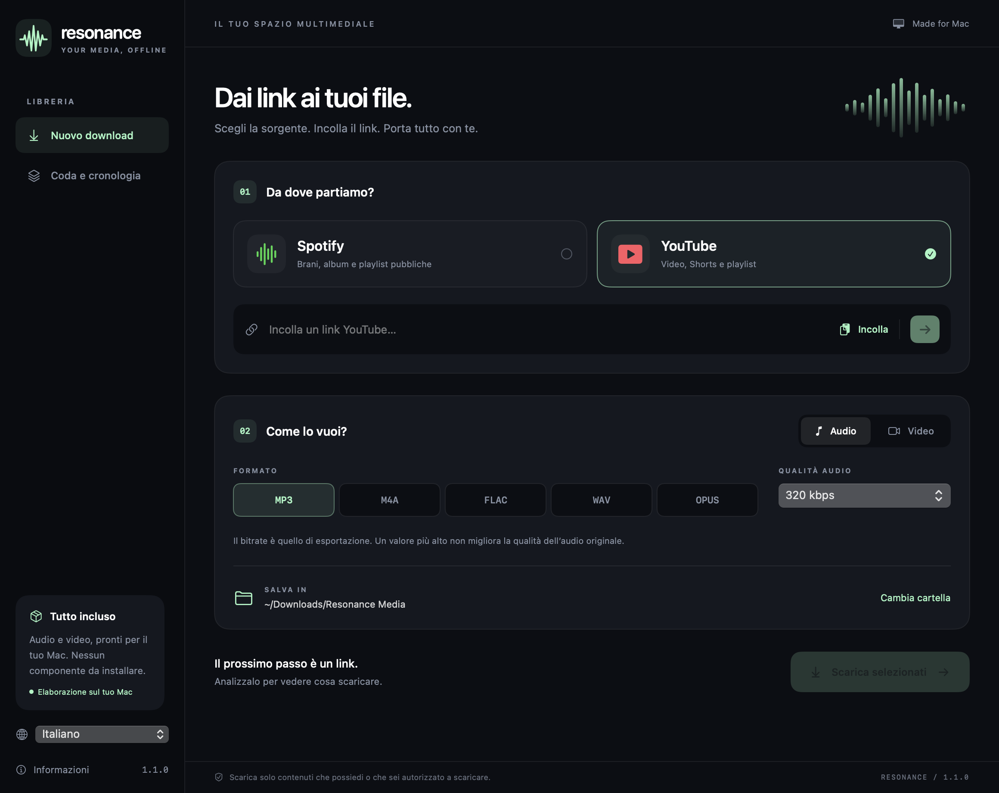

# Resonance

App macOS nativa e compatta per preparare file audio e video da link. Interfaccia in italiano e inglese, coda locale e aggiornamenti firmati da GitHub.

[Scarica l’ultima versione](https://github.com/tmacchioni/Resonance/releases/latest) · [Documentazione completa](../README.md)

## Installazione e uso

Apri l’installer `.pkg` per installare Resonance in Applicazioni. Richiede **macOS 13 o successivo**, su Intel o Apple Silicon. Tutti i componenti necessari sono inclusi: non servono Homebrew, Python o altri programmi.

Scegli Spotify o YouTube, incolla un link, controlla l’anteprima, seleziona formato/qualità e avvia il download. Puoi cambiare lingua nella barra laterale; la preferenza viene salvata e applicata subito. La coda permette di annullare, riprovare e mostrare i file nel Finder.

L’app controlla gli aggiornamenti all’avvio e ogni giorno mentre è aperta. Chiede sempre conferma prima di installare. Puoi disattivare i controlli automatici in Informazioni e avviare un controllo dal menu Resonance. Le nuove versioni includono anche gli aggiornamenti dei motori esterni verificati.

La prima release pubblica è firmata ad hoc e non notarizzata da Apple: Gatekeeper può richiedere l’approvazione in Impostazioni di Sistema → Privacy e sicurezza. La firma degli aggiornamenti Sparkle resta indipendente e verifica l’origine dei pacchetti. Non disattivare globalmente le protezioni del sistema.

## Formati e limiti

Audio: MP3, M4A/AAC, FLAC, WAV e Opus. Video: MP4, MKV e WebM. Qualità audio e risoluzione massima sono configurabili.

Spotify viene usato per i metadati pubblici; l’audio viene cercato su YouTube. La registrazione può differire e l’anteprima Spotify può includere solo parte di una raccolta. Non sono garantite playlist complete di qualsiasi lunghezza. Puoi indicare il video esatto per ogni brano.

Il bitrate scelto non migliora la sorgente. Convertire in FLAC non recupera la qualità persa. La disponibilità dipende dal servizio e dai vincoli del singolo contenuto. Scarica solo contenuti tuoi o che sei autorizzato a scaricare.

## Open source

Codice GPL-3.0-or-later. Il repository contiene istruzioni, traduzioni, build riproducibili, test e workflow per le release. I componenti esterni conservano le loro licenze, incluse nell’app; le release contengono anche i sorgenti necessari delle build multimediali.

Per compilazione, contributi e dettagli sugli aggiornamenti consulta [README](../README.md), [CONTRIBUTING](../CONTRIBUTING.md) e [RELEASING](RELEASING.md).

Per aggiornare i componenti esterni ora basta modificare versione e checksum in `vendor/manifest.json`: gli script ricavano da lì tutti i riferimenti. La [guida alle dipendenze](DEPENDENCIES.md) include i passaggi e i controlli.
